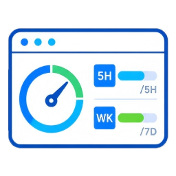
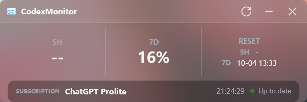
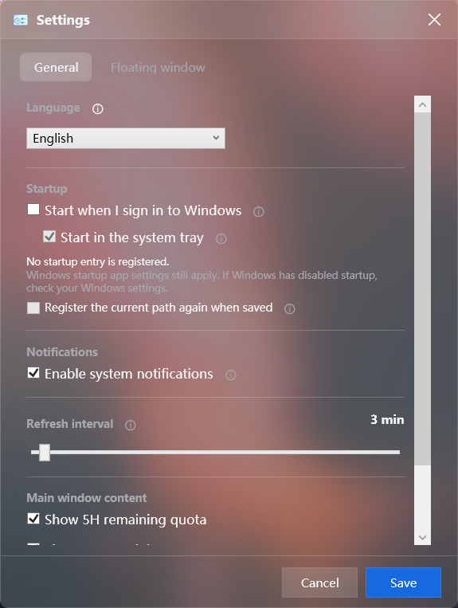

<p align="center">
  
</p>

<h1 align="center">CodexMonitor</h1>

<p align="center">Keep your Codex quota in view with a compact floating window on Windows.</p>

<p align="center">
  <a href="https://github.com/LuoIsHere/CodexMonitor/releases"></a>
  <a href="LICENSE"></a>
  <a href="https://github.com/LuoIsHere/CodexMonitor/releases"></a>
</p>

<p align="center">English · <a href="docs/README_cn.md">简体中文</a> · <a href="docs/README_hk.md">繁體中文（香港）</a></p>



CodexMonitor shows your remaining Codex quota in a compact floating window on the desktop. Lock it to keep it on top and let mouse clicks pass through. The main window shows the quota for the five-hour and seven-day periods, their reset times and the subscription type, and CodexMonitor keeps running in the notification area when the main window is closed. All data is read through the Codex installed on your computer.

## Features

**Quota**
- Remaining quota for the five-hour (`5H`) and seven-day (`7D`) windows, reset times in local time, and the subscription type.
- Accounts that use a token or API key show `None` for quota and refresh time, and `-` for reset times.

**Refresh**
- One read at startup, **Refresh now** for a manual read, and automatic refresh every 1–60 minutes (3 minutes by default).
- If a read fails, the last successful data stays on screen with the failure status. Optional system notifications give a short reason; details are written to the log.

**Windows**
- Closing the main window keeps CodexMonitor running in the notification area.
- The floating window has its own display fields and remembers its position. When locked, it stays on top and lets mouse clicks pass through. Its status dot stays visible with any combination of fields.
- The main window and the floating window share one monitor and show the same data.

**System**
- Optional start at Windows sign-in for the current user, with only the notification-area icon or with the main window.
- Single instance: a manual start restores the running copy; an automatic start leaves it as it is.

**Interface**
- Simplified Chinese (default), English and Traditional Chinese (Hong Kong) for the main window, settings, notification-area menu and notifications. The floating window keeps its English labels.
- Settings use the main window's Acrylic background, with a dark fallback when Windows transparency effects are off. The ⓘ icons explain each setting.

## Design principles

- **Read through Codex only.** Quota and account data come from the local Codex app-server. CodexMonitor does not read Codex credential files, does not request token values and makes no network requests of its own. Account email fields are ignored.
- **No process left running.** A Codex app-server is started for each read and closed when the read ends.
- **Standard user permissions.** No administrator rights are needed. Startup uses only the `CodexMonitor` value under the current user's Windows Run key, and it is changed only when you save a startup setting.
- **No third-party packages.** CodexMonitor is built on .NET 10 and WPF without third-party NuGet dependencies.

## Requirements

- Windows 10 version 1809 or later, x64. Windows 11 is recommended.
- Codex for Windows, installed and signed in.
- The framework-dependent package needs the [.NET 10 Desktop Runtime](https://dotnet.microsoft.com/download/dotnet/10.0) (x64). The self-contained package needs no separate runtime.

## Installation

1. Download a package from the [Releases page](https://github.com/LuoIsHere/CodexMonitor/releases):

   | Package | File | Separate runtime |
   | --- | --- | --- |
   | Self-contained | `CodexMonitor-<version>-win-x64-self-contained.exe` or `.zip` | Not needed |
   | Framework-dependent | `CodexMonitor-<version>-win-x64-framework-dependent.exe` or `.zip` | .NET 10 Desktop Runtime x64 |

   `<version>` is the release version, for example `0.3.4`. All packages have the same features.
2. Run the single EXE directly, or extract the ZIP and run `CodexMonitor.exe`.

CodexMonitor is not code-signed. On first start, Windows SmartScreen may show "Windows protected your PC"; choose **More info**, then **Run anyway**.

**Upgrading:** exit the running copy with **Exit** in the notification-area menu, then run the new version. Settings in `%LOCALAPPDATA%\CodexMonitor` are kept. If startup at sign-in is on and the new version has a different file name or location, open **Settings**, select **Register the current path again when saved** and save.

## Getting started

1. Run CodexMonitor. The main window opens and reads the quota once. Click **Refresh now** to read it again at any time.
2. Close the main window to keep monitoring in the notification area. Left-click the icon to restore the window; right-click it for **Settings**, the floating-window options and **Exit**.
3. In **Settings**, choose the language, refresh interval, notifications and the fields shown in each window, then click **Save**. The language changes when you save. Hover over ⓘ for help; with the keyboard, press Tab to focus ⓘ, Enter or Space to open it, and Esc to close it.
4. Select **Enable floating window** in the notification-area menu or in Settings. Drag the floating window while it is unlocked. **Lock floating window** keeps it on top and lets mouse clicks pass through; unlock it from the notification-area menu or Settings.




Floating-window status dot: gray = waiting, blue = refreshing, green = success, red = failed with no data, orange = failed with older data kept.

## Start at Windows sign-in

In **Settings → General**, select **Start when I sign in to Windows** and save. It is off by default and needs no administrator rights.

- With **Start in the system tray** selected (the default), an automatic start shows only the notification-area icon and any enabled floating window. Clear it to show the main window.
- A manual start always opens or restores the main window.
- **Windows Startup apps settings still decide whether CodexMonitor runs.** It does not re-enable an entry turned off in Windows Settings or Task Manager.
- After moving the program, run it from the new location, select **Register the current path again when saved** and save.

## Supported Codex versions

CodexMonitor talks to the local Codex app-server. Its protocol can change between Codex releases, so a new Codex version may need a CodexMonitor update.

Verified combinations:

| CodexMonitor | Codex |
| --- | --- |
| 0.3.4 | `codex-cli 0.155.0-alpha.2.6`, `codex-cli 0.171.0-alpha.13.2` |
| 0.3.2 | Codex desktop 26.917.51856 (`codex-cli 0.155.0-alpha.16`) |
| 0.3.1 | `codex-cli 0.155.0-alpha.2.6` |
| 0.3.0 | `codex-cli 0.147.0-alpha.6.6` |

`codex.exe` is located in this order:

1. The `codexExecutable` setting.
2. The `CODEX_EXE` environment variable.
3. The most recently updated folder under `%LOCALAPPDATA%\OpenAI\Codex\bin`.
4. The folders on `PATH`.

## Settings and logs

```text
%LOCALAPPDATA%\CodexMonitor\settings.json
%LOCALAPPDATA%\CodexMonitor\logs\codex-monitor.log
```

- Set the `CODEX_MONITOR_HOME` environment variable to keep settings and logs in another folder.
- Settings from older versions keep their options after an upgrade. Edits to `settings.json` take effect after a restart; turn on startup at sign-in in the Settings window, not in the file.
- The log records read results and errors. Errors can include local paths; check the log before sharing it.

## How it works

- `CodexMonitor.Core`: models, display formatting and refresh state.
- `CodexMonitor.Infrastructure`: communication with Codex, JSON parsing, settings, logging and startup registration.
- `CodexMonitor.App`: WPF windows, notification-area lifecycle, single-instance activation and refresh scheduling.

For each read, CodexMonitor starts `codex.exe app-server` and exchanges JSON messages with it over standard input and output. When the read ends, it closes the server's input and waits up to 5 seconds for it to exit; only then is the process tree stopped. The last successful result is kept in memory only.

## Building from source

Requirements: Windows and the .NET 10 SDK.

```powershell
dotnet build .\CodexMonitor.sln -c Release
```

```powershell
dotnet run --project .\tests\CodexMonitor.Tests\CodexMonitor.Tests.csproj -c Release
```

The tests use simulated startup storage and temporary settings; they do not change the real startup entry. An optional live probe reads the quota through the installed Codex:

```powershell
dotnet run --project .\tests\CodexMonitor.Tests\CodexMonitor.Tests.csproj -c Release -- --live
```

To create the four release packages in `artifacts\`:

```powershell
.\build\Publish.ps1
```

## Documentation

- [CHANGELOG.md](CHANGELOG.md): changes in the current version.
- [docs/CHANGELOG.md](docs/CHANGELOG.md): full list of changes in every version.
- [docs/README_cn.md](docs/README_cn.md), [docs/README_hk.md](docs/README_hk.md): this document in Simplified Chinese and Traditional Chinese (Hong Kong).
- [LICENSE](LICENSE): the MIT License.

## License and disclaimer

Copyright (c) 2026 luoishere

CodexMonitor is released under the [MIT License](LICENSE).

CodexMonitor is a personal project developed with assistance from OpenAI Codex. It is provided **without any warranty** and may contain defects. Quota figures are read from Codex and are for reference only.

## Acknowledgements and trademarks

The quota display was inspired by [CodexQuotaMonitor](https://github.com/DiMY-CN/CodexQuotaMonitor), and the compact Windows monitor design by [TrafficMonitor](https://github.com/zhongyang219/TrafficMonitor).

OpenAI is a trademark of OpenAI, and Codex is an OpenAI product. CodexMonitor is an independent project. It is not affiliated with or endorsed by OpenAI, and no OpenAI staff are involved.
