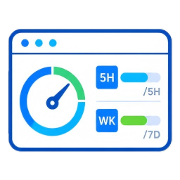
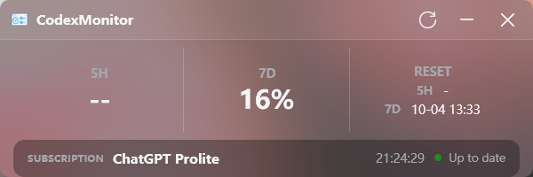
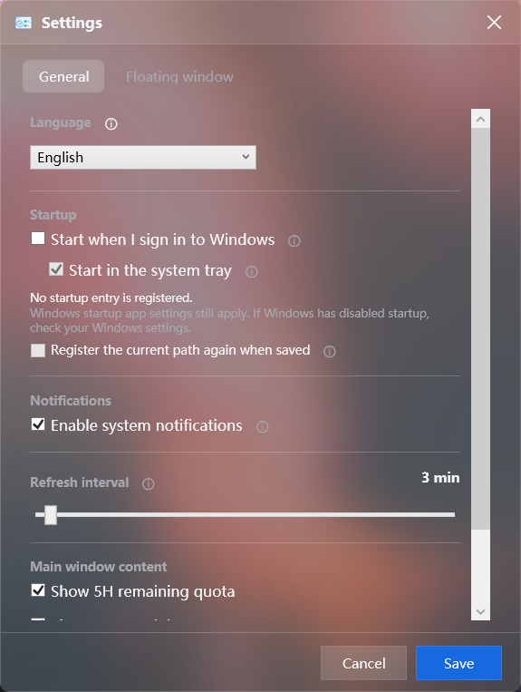

<p align="center">
  
</p>

<h1 align="center">CodexMonitor</h1>

<p align="center">用小巧的悬浮窗，在 Windows 桌面上随时查看 Codex 额度。</p>

<p align="center">
  <a href="https://github.com/LuoIsHere/CodexMonitor/releases"></a>
  <a href="../LICENSE"></a>
  <a href="https://github.com/LuoIsHere/CodexMonitor/releases"></a>
</p>

<p align="center"><a href="../README.md">English</a> · 简体中文 · <a href="README_hk.md">繁體中文（香港）</a></p>



CodexMonitor 用桌面上的小巧悬浮窗显示 Codex 剩余额度。锁定后，悬浮窗保持置顶，鼠标点击可以穿透。主窗口显示 5 小时和 7 天两个时段的额度、各自的重置时间以及订阅类型；关闭主窗口后，程序继续在通知区域运行。所有数据都通过本机安装的 Codex 读取。

## 功能

**额度**
- 显示 5 小时（`5H`）和 7 天（`7D`）窗口的剩余额度、按本地时间显示的重置时间，以及订阅类型。
- 使用令牌或 API Key 的账号，额度和刷新时间显示为 `None`，重置时间显示为 `-`。

**刷新**
- 启动时读取一次；可用“立即刷新”手动读取，也可每 1–60 分钟自动刷新（默认 3 分钟）。
- 读取失败时，继续显示最近一次成功的数据并标明失败状态。可选的系统通知会给出简短原因，详细信息写入日志。

**窗口**
- 关闭主窗口后，CodexMonitor 继续在通知区域运行。
- 悬浮窗可单独设置显示内容，并记住位置。锁定后保持置顶，鼠标点击可以穿透。无论显示哪些内容，状态点始终可见。
- 主窗口和悬浮窗共用同一个监控，显示相同的数据。

**系统**
- 可选在当前用户登录 Windows 时自动启动，只显示通知区域图标，或同时显示主窗口。
- 单实例运行：手动启动会恢复已在运行的程序；自动启动不会打扰已在运行的程序。

**界面**
- 主窗口、设置、通知区域菜单和系统通知支持简体中文（默认）、英语和繁体中文（香港）。悬浮窗保留英文标签。
- 设置窗口沿用主窗口的 Acrylic 背景；关闭 Windows 透明效果时使用深色背景。每项设置旁的 ⓘ 提供说明。

## 设计原则

- **只通过 Codex 读取。** 额度和账号数据来自本机的 Codex app-server。CodexMonitor 不读取 Codex 的凭据文件，不请求令牌内容，自身也不发起任何网络请求；账号邮箱字段会被忽略。
- **不留后台进程。** 每次读取时启动一个 Codex app-server，读取结束后关闭。
- **普通用户权限。** 无需管理员权限。自动启动只使用当前用户 Windows Run 注册表项下的 `CodexMonitor` 值，并且只在保存启动设置时修改。
- **无第三方包。** 基于 .NET 10 和 WPF，不使用第三方 NuGet 依赖。

## 系统要求

- Windows 10 1809 或更高版本，x64；推荐 Windows 11。
- 已安装并登录的 Windows 版 Codex。
- 依赖运行时的发布包需要 [.NET 10 桌面运行时](https://dotnet.microsoft.com/download/dotnet/10.0)（x64）；自包含的发布包无需另装运行时。

## 安装

1. 从 [Releases 页面](https://github.com/LuoIsHere/CodexMonitor/releases) 下载发布包：

   | 发布包 | 文件 | 另装运行时 |
   | --- | --- | --- |
   | 自包含 | `CodexMonitor-<版本号>-win-x64-self-contained.exe` 或 `.zip` | 不需要 |
   | 依赖运行时 | `CodexMonitor-<版本号>-win-x64-framework-dependent.exe` 或 `.zip` | .NET 10 桌面运行时 x64 |

   `<版本号>` 为发布版本号，例如 `0.3.4`。各发布包功能相同。
2. 直接运行单个 EXE，或解压 ZIP 后运行 `CodexMonitor.exe`。

CodexMonitor 没有代码签名。首次运行时，Windows SmartScreen 可能显示“Windows 已保护你的电脑”；点击“更多信息”，再点击“仍要运行”。

**升级：** 先在通知区域菜单中选择“退出程序”，再运行新版本。`%LOCALAPPDATA%\CodexMonitor` 中的设置会保留。如果已开启登录时自动启动，且新版本的文件名或位置与旧版本不同，请打开“设置”，勾选“重新登记当前路径（保存后执行）”并保存。

## 快速上手

1. 运行 CodexMonitor。主窗口打开后会读取一次额度；随时可点击“立即刷新”重新读取。
2. 关闭主窗口后，程序继续在通知区域监控。左键单击图标恢复窗口；右键单击图标可打开“设置”、悬浮窗选项和“退出程序”。
3. 在“设置”中选择界面语言、刷新间隔、通知以及各窗口的显示内容，然后点击“保存”。界面语言在保存后切换。鼠标移到 ⓘ 上查看说明；使用键盘时，按 Tab 将焦点移到 ⓘ，按 Enter 或空格打开，按 Esc 关闭。
4. 在通知区域菜单或“设置”中勾选“启用悬浮窗”。悬浮窗未锁定时可以拖动；勾选“锁定悬浮窗”后，悬浮窗保持置顶，鼠标点击可以穿透。可在通知区域菜单或“设置”中解锁。




悬浮窗状态点：灰色表示等待，蓝色表示正在刷新，绿色表示成功，红色表示失败且没有数据，橙色表示失败但保留了旧数据。

## 登录 Windows 时自动启动

在“设置 → 常规”中勾选“登录 Windows 后自动启动”并保存。此选项默认关闭，无需管理员权限。

- 勾选“启动后最小化到托盘”（默认）时，自动启动只显示通知区域图标和已启用的悬浮窗；取消勾选则显示主窗口。
- 手动启动时总是打开或恢复主窗口。
- **是否实际运行仍由 Windows 的启动应用设置决定。** 在 Windows 设置或任务管理器中禁用的启动项，CodexMonitor 不会重新启用。
- 移动程序后，从新位置运行，勾选“重新登记当前路径（保存后执行）”并保存。

## 支持的 Codex 版本

CodexMonitor 与本机的 Codex app-server 通信。该协议可能随 Codex 版本变化，新版 Codex 可能需要配合更新 CodexMonitor。

已验证的组合：

| CodexMonitor | Codex |
| --- | --- |
| 0.3.4 | `codex-cli 0.155.0-alpha.2.6`、`codex-cli 0.171.0-alpha.13.2` |
| 0.3.2 | Codex 桌面版 26.917.51856（`codex-cli 0.155.0-alpha.16`） |
| 0.3.1 | `codex-cli 0.155.0-alpha.2.6` |
| 0.3.0 | `codex-cli 0.147.0-alpha.6.6` |

`codex.exe` 按以下顺序查找：

1. 设置项 `codexExecutable`。
2. 环境变量 `CODEX_EXE`。
3. `%LOCALAPPDATA%\OpenAI\Codex\bin` 下最近更新的文件夹。
4. `PATH` 中的文件夹。

## 设置与日志

```text
%LOCALAPPDATA%\CodexMonitor\settings.json
%LOCALAPPDATA%\CodexMonitor\logs\codex-monitor.log
```

- 设置环境变量 `CODEX_MONITOR_HOME` 可将设置和日志保存到其他文件夹。
- 旧版本的设置在升级后保留原有选项。修改 `settings.json` 后需重启程序才生效；登录时自动启动请在设置窗口中开启，不要直接修改文件。
- 日志记录读取结果和错误。错误信息可能包含本机路径，分享日志前请先检查。

## 工作原理

- `CodexMonitor.Core`：数据模型、显示格式和刷新状态。
- `CodexMonitor.Infrastructure`：与 Codex 通信、JSON 解析、设置、日志和启动项登记。
- `CodexMonitor.App`：WPF 窗口、通知区域生命周期、单实例激活和刷新调度。

每次读取时，CodexMonitor 启动 `codex.exe app-server`，通过标准输入输出与其交换 JSON 消息。读取结束后，关闭 app-server 的输入并等待其自行退出，最多等待 5 秒，超时后才结束整个进程树。最近一次成功的结果只保存在内存中。

## 从源码构建

要求：Windows 和 .NET 10 SDK。

```powershell
dotnet build .\CodexMonitor.sln -c Release
```

```powershell
dotnet run --project .\tests\CodexMonitor.Tests\CodexMonitor.Tests.csproj -c Release
```

测试使用模拟的启动项存储和临时设置，不会修改真实的启动项。可选的实时探测会通过已安装的 Codex 读取额度：

```powershell
dotnet run --project .\tests\CodexMonitor.Tests\CodexMonitor.Tests.csproj -c Release -- --live
```

在 `artifacts\` 中生成四个发布包：

```powershell
.\build\Publish.ps1
```

## 文档

- [CHANGELOG.md](../CHANGELOG.md)：当前版本的更新内容（英文）。
- [docs/CHANGELOG.md](CHANGELOG.md)：所有版本的完整更新记录（英文）。
- [README.md](../README.md)、[docs/README_hk.md](README_hk.md)：本文档的英文版和繁体中文（香港）版。
- [LICENSE](../LICENSE)：MIT 许可证。

## 许可与免责声明

Copyright (c) 2026 luoishere

CodexMonitor 以 [MIT 许可证](../LICENSE) 发布。

CodexMonitor 是借助 OpenAI Codex 开发的个人项目，**不提供任何担保**，可能存在缺陷。额度数据读取自 Codex，仅供参考。

## 致谢与商标

额度显示参考了 [CodexQuotaMonitor](https://github.com/DiMY-CN/CodexQuotaMonitor)，小巧的 Windows 监控工具设计参考了 [TrafficMonitor](https://github.com/zhongyang219/TrafficMonitor)。

OpenAI 是 OpenAI 的商标，Codex 是 OpenAI 的产品。CodexMonitor 是独立项目，与 OpenAI 没有隶属关系，也未获 OpenAI 认可，且没有 OpenAI 人员参与。
