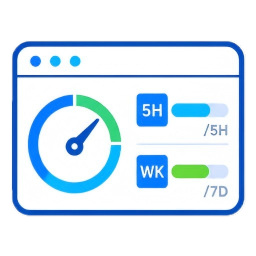
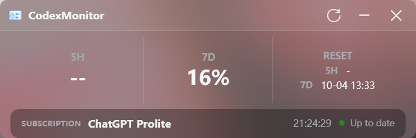
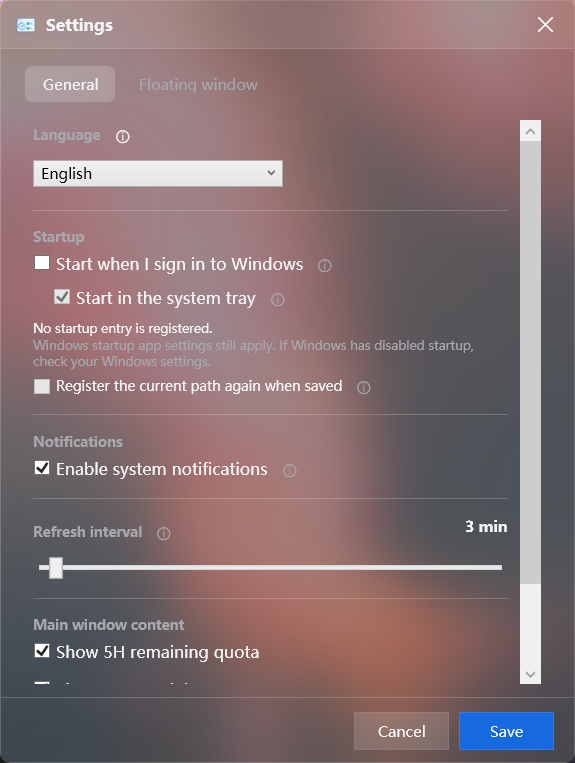

<p align="center">
  
</p>

<h1 align="center">CodexMonitor</h1>

<p align="center">以小巧的浮動視窗，在 Windows 桌面上隨時查看 Codex 額度。</p>

<p align="center">
  <a href="https://github.com/LuoIsHere/CodexMonitor/releases"></a>
  <a href="../LICENSE"></a>
  <a href="https://github.com/LuoIsHere/CodexMonitor/releases"></a>
</p>

<p align="center"><a href="../README.md">English</a> · <a href="README_cn.md">简体中文</a> · 繁體中文（香港）</p>



CodexMonitor 以桌面上的小巧浮動視窗顯示 Codex 剩餘額度。鎖定後，浮動視窗會保持置頂，滑鼠點擊可以穿透。主視窗顯示 5 小時及 7 天兩個時段的額度、各自的重設時間及訂閱類型；關閉主視窗後，程式會繼續在通知區域執行。所有資料均透過本機安裝的 Codex 讀取。

## 功能

**額度**
- 顯示 5 小時（`5H`）及 7 天（`7D`）時段的剩餘額度、以本地時間顯示的重設時間，以及訂閱類型。
- 使用權杖或 API Key 的帳戶，額度及更新時間顯示為 `None`，重設時間顯示為 `-`。

**更新**
- 啟動時讀取一次；可按「立即更新」手動讀取，亦可每 1–60 分鐘自動更新（預設為 3 分鐘）。
- 讀取失敗時，繼續顯示最近一次成功取得的資料，並標示失敗狀態。可選用的系統通知會提供簡短原因，詳細資料會寫入日誌。

**視窗**
- 關閉主視窗後，CodexMonitor 會繼續在通知區域執行。
- 浮動視窗可獨立設定顯示內容，並記住位置。鎖定後會保持置頂，滑鼠點擊可以穿透。無論顯示哪些內容，狀態點都會保持可見。
- 主視窗與浮動視窗共用同一個監控，顯示相同的資料。

**系統**
- 可選擇在目前使用者登入 Windows 時自動啟動，只顯示通知區域圖示，或同時顯示主視窗。
- 只執行一個執行個體：手動啟動會還原正在執行的程式；自動啟動則不會影響正在執行的程式。

**介面**
- 主視窗、設定、通知區域選單及系統通知支援簡體中文（預設）、英文及繁體中文（香港）。浮動視窗保留英文標籤。
- 設定視窗沿用主視窗的 Acrylic 背景；關閉 Windows 透明效果時會改用深色背景。每項設定旁的 ⓘ 提供說明。

## 設計原則

- **只透過 Codex 讀取。** 額度及帳戶資料來自本機的 Codex app-server。CodexMonitor 不會讀取 Codex 的憑證檔案，不會要求取得權杖內容，本身亦不會發出任何網絡要求；帳戶的電郵地址欄位會被忽略。
- **不留背景程序。** 每次讀取時啟動一個 Codex app-server，讀取完成後關閉。
- **一般使用者權限。** 毋須管理員權限。自動啟動只使用目前使用者 Windows Run 登錄項目下的 `CodexMonitor` 值，而且只會在儲存啟動設定時修改。
- **不使用第三方套件。** 以 .NET 10 及 WPF 建置，沒有第三方 NuGet 相依套件。

## 系統要求

- Windows 10 1809 或以上版本，x64；建議使用 Windows 11。
- 已安裝並登入的 Windows 版 Codex。
- 依賴執行階段的發佈套件需要 [.NET 10 桌面執行階段](https://dotnet.microsoft.com/download/dotnet/10.0)（x64）；自包含的發佈套件毋須另行安裝執行階段。

## 安裝

1. 從 [Releases 頁面](https://github.com/LuoIsHere/CodexMonitor/releases) 下載發佈套件：

   | 發佈套件 | 檔案 | 另行安裝執行階段 |
   | --- | --- | --- |
   | 自包含 | `CodexMonitor-<版本號>-win-x64-self-contained.exe` 或 `.zip` | 不需要 |
   | 依賴執行階段 | `CodexMonitor-<版本號>-win-x64-framework-dependent.exe` 或 `.zip` | .NET 10 桌面執行階段 x64 |

   `<版本號>` 為發佈版本號，例如 `0.3.4`。各發佈套件的功能相同。
2. 直接執行單一 EXE，或將 ZIP 解壓縮後執行 `CodexMonitor.exe`。

CodexMonitor 沒有程式碼簽署。首次執行時，Windows SmartScreen 可能會顯示「Windows 已保護您的電腦」；請按「其他資訊」，再按「仍要執行」。

**升級：** 先在通知區域選單選擇「結束程式」，再執行新版本。`%LOCALAPPDATA%\CodexMonitor` 中的設定會保留。如已啟用登入時自動啟動，而新版本的檔案名稱或位置與舊版本不同，請開啟「設定」，勾選「重新登記目前路徑（儲存後執行）」並儲存。

## 快速入門

1. 執行 CodexMonitor。主視窗開啟後會讀取一次額度；隨時可按「立即更新」重新讀取。
2. 關閉主視窗後，程式會繼續在通知區域監控。以滑鼠左鍵按一下圖示可還原視窗；按右鍵可開啟「設定」、浮動視窗選項及「結束程式」。
3. 在「設定」中選擇介面語言、更新間隔、通知及各視窗的顯示內容，然後按「儲存」。介面語言會在儲存後切換。將滑鼠移至 ⓘ 可查看說明；使用鍵盤時，按 Tab 將焦點移至 ⓘ，按 Enter 或空格鍵開啟，按 Esc 關閉。
4. 在通知區域選單或「設定」中勾選「啟用浮動視窗」。浮動視窗未鎖定時可以拖動；勾選「鎖定浮動視窗」後，浮動視窗會保持置頂，滑鼠點擊可以穿透。可在通知區域選單或「設定」中解鎖。




浮動視窗狀態點：灰色表示等候，藍色表示正在更新，綠色表示成功，紅色表示失敗且沒有資料，橙色表示失敗但保留了舊資料。

## 登入 Windows 時自動啟動

在「設定 → 一般」勾選「登入 Windows 後自動啟動」並儲存。此選項預設關閉，毋須管理員權限。

- 勾選「啟動後最小化至通知區域」（預設）時，自動啟動只會顯示通知區域圖示及已啟用的浮動視窗；取消勾選則會顯示主視窗。
- 手動啟動時一律開啟或還原主視窗。
- **是否實際執行仍由 Windows 的啟動應用程式設定決定。** 在 Windows 設定或工作管理員中停用的啟動項目，CodexMonitor 不會重新啟用。
- 移動程式後，從新位置執行，勾選「重新登記目前路徑（儲存後執行）」並儲存。

## 支援的 Codex 版本

CodexMonitor 與本機的 Codex app-server 通訊。此通訊協定可能隨 Codex 版本改變，新版 Codex 可能需要配合更新 CodexMonitor。

已驗證的組合：

| CodexMonitor | Codex |
| --- | --- |
| 0.3.4 | `codex-cli 0.155.0-alpha.2.6`、`codex-cli 0.171.0-alpha.13.2` |
| 0.3.2 | Codex 桌面版 26.917.51856（`codex-cli 0.155.0-alpha.16`） |
| 0.3.1 | `codex-cli 0.155.0-alpha.2.6` |
| 0.3.0 | `codex-cli 0.147.0-alpha.6.6` |

`codex.exe` 會按以下順序尋找：

1. 設定項目 `codexExecutable`。
2. 環境變數 `CODEX_EXE`。
3. `%LOCALAPPDATA%\OpenAI\Codex\bin` 下最近更新的資料夾。
4. `PATH` 中的資料夾。

## 設定與日誌

```text
%LOCALAPPDATA%\CodexMonitor\settings.json
%LOCALAPPDATA%\CodexMonitor\logs\codex-monitor.log
```

- 設定環境變數 `CODEX_MONITOR_HOME` 可將設定及日誌儲存到其他資料夾。
- 舊版本的設定在升級後會保留原有選項。修改 `settings.json` 後須重新啟動程式才會生效；登入時自動啟動請在設定視窗中啟用，不要直接修改檔案。
- 日誌會記錄讀取結果及錯誤。錯誤資料可能包含本機路徑，分享日誌前請先檢查。

## 運作方式

- `CodexMonitor.Core`：資料模型、顯示格式及更新狀態。
- `CodexMonitor.Infrastructure`：與 Codex 通訊、JSON 解析、設定、日誌及啟動項目登記。
- `CodexMonitor.App`：WPF 視窗、通知區域生命週期、單一執行個體啟用及更新排程。

每次讀取時，CodexMonitor 會啟動 `codex.exe app-server`，透過標準輸入輸出與其交換 JSON 訊息。讀取完成後，程式會關閉 app-server 的輸入並等待其自行結束，最多等待 5 秒，逾時才會結束整個程序樹狀結構。最近一次成功取得的結果只保存在記憶體中。

## 從原始碼建置

要求：Windows 及 .NET 10 SDK。

```powershell
dotnet build .\CodexMonitor.sln -c Release
```

```powershell
dotnet run --project .\tests\CodexMonitor.Tests\CodexMonitor.Tests.csproj -c Release
```

測試使用模擬的啟動項目儲存及臨時設定，不會修改實際的啟動項目。可選用的實際讀取測試會透過已安裝的 Codex 讀取額度：

```powershell
dotnet run --project .\tests\CodexMonitor.Tests\CodexMonitor.Tests.csproj -c Release -- --live
```

在 `artifacts\` 中產生四個發佈套件：

```powershell
.\build\Publish.ps1
```

## 文件

- [CHANGELOG.md](../CHANGELOG.md)：目前版本的更新內容（英文）。
- [docs/CHANGELOG.md](CHANGELOG.md)：所有版本的完整更新記錄（英文）。
- [README.md](../README.md)、[docs/README_cn.md](README_cn.md)：本文件的英文版及簡體中文版。
- [LICENSE](../LICENSE)：MIT 授權條款。

## 授權與免責聲明

Copyright (c) 2026 luoishere

CodexMonitor 以 [MIT 授權條款](../LICENSE) 發佈。

CodexMonitor 是借助 OpenAI Codex 開發的個人項目，**不提供任何擔保**，可能存在缺陷。額度資料讀取自 Codex，僅供參考。

## 鳴謝與商標

額度顯示參考了 [CodexQuotaMonitor](https://github.com/DiMY-CN/CodexQuotaMonitor)，小巧的 Windows 監察工具設計參考了 [TrafficMonitor](https://github.com/zhongyang219/TrafficMonitor)。

OpenAI 是 OpenAI 的商標，Codex 是 OpenAI 的產品。CodexMonitor 是獨立項目，與 OpenAI 沒有隸屬關係，亦未獲 OpenAI 認可，且沒有 OpenAI 人員參與。
